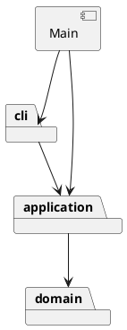

# 架构方案

## 本轮边界

第一轮实现 init、create rect、tree（含 tree id）、move；第二轮增加 circle；第三轮增加 ellipse、line、text。
第四轮增加 g 容器、create ... in、嵌套 tree 和整组 move；第五轮增加 scale、set、show。
第六轮增加 delete、front、back；第七轮增加 group、addto、ungroup；第八轮增加 undo/redo 与 init 历史边界。
后续继续 help/canvas 和文件读写。
当前不是完整的 Phase 1 提交版本；不创建 final tag。

## 模块职责与依赖

| 目录 | 职责 | 允许依赖 |
| --- | --- | --- |
| src/domain | Shape、五类叶子、GroupShape、SvgDocument；封装几何行为、对象树、唯一 id 和查找 | 本模块、语言标准库 |
| src/application | 当前文档会话、Command/EditCommand 与具体命令、HistoryEntry；管理编辑与快照历史，定义输入 token 的只读元数据 | domain、本模块 |
| src/cli | 分词、唯一命令分派入口、终端读写和错误显示 | application，本模块 |
| src/Main.ts | 组装并启动应用 | cli、application |

领域层不读终端、不写 console、不访问文件。命令只调用对象行为，不直接改坐标。
初期把文本描述方法放在模型中，减少学习入口；树和显示复杂后评估提取 presentation。

## 设计模式

- Command（任务书要求）：所有具体命令实现相同 execute 契约，本轮新增 UndoCommand、RedoCommand。十类编辑继承 EditCommand，经统一 execute 模板在会话副本上调用 apply；查询、init 和历史操作仍直接继承 Command。
- 快照与封装：HistoryEntry 私有保存编辑前后的独立文档，恢复时再复制；EditorSession 管理两栈，不访问私有几何字段。具体图形用多态 cloneGeometry 复制自身数据，Shape 统一复制样式，不增加类型名称分派。
- 多态与封装：Shape 定义行为，RectShape/CircleShape/EllipseShape/LineShape/TextShape 各自实现几何变化；文档保存 Shape，MoveCommand 不判断图形类型。
- Composite：GroupShape 与叶子均为 Shape；组递归准备孩子的移动/缩放，tree 通过统一的 getChildren 遍历。普通 g 的 set 只改变自身样式，不向孩子复制；delete 通过 Shape.walk 收集整棵子树，命令不判断图形类型。
- 移动与缩放的准备与提交：Shape.move/scale 先校验参数，再调用受保护的 prepareMove/prepareScale。叶子计算新几何值，组汇总孩子的更新；全部准备成功才同步执行只赋值的回调。回调不保存为历史，不把此机制表述为所有编辑命令的通用事务。
- 属性封装：Shape 私有样式集合统一管理 fill/stroke/stroke-width；各子类通过 setGeometryAttribute 校验自身白名单。单属性先校验再赋值；geometryAttributes 返回展示用快照，字段仍是私有状态。
- 树与索引一致性：删除由 SvgDocument 先定位父级、收集子树，再从父级摘离并清理所有后代 ID；重排只改同级列表。可能失败的查找与归属检查在修改之前完成。
- 多父级编辑：group/addTo/ungroup 在文档内部建立局部孩子列表替换计划；applyStructure 验证新树并统一提交。单次领域操作内部保留既有对象身份；会话外层则使用完整文档副本。两者职责不同，局部列表计划不当作撤销快照。
- 仅两处名称分派：CommandDispatcher（命令名 → 命令类）与 ShapeFactory（类型名 → 图形类）。两处均标注待重构为注册入口；本轮不制作动态插件框架。

## 变化点假设与取舍

1. 新增图形：保留 Shape 行为契约和集中工厂；按增量增加具体类。
2. 新增命令或撤销：用户第八轮选择文档快照，优先保证几何、样式和树结构完整恢复。新增编辑继承 EditCommand，新增图形实现多态复制；每条记录保存前后两份文档，内存随文档规模和历史长度增长，当前不设历史截断上限。
3. 图形嵌套：文档维护根节点顺序及全局 id 索引；GroupShape 管理私有孩子。删除同步清理索引，分组迁移验证新树并生成对应索引；只有新增/解散组改变节点集合。
4. 终端以外的入口：命令和领域对象不依赖终端，可以复用。
5. 文件读写：届时新增基础设施模块，当前不提前创建空接口。
6. 父级查询：show、删除、重排与迁移共用 findParent，单次扫描复杂度 O(N)。分组查共同祖先时会多次扫描，本轮保留便于复习的实现，不承诺整条 group 为线性复杂度；大文档性能需求出现后再考虑父级索引。
7. 分组位置：任务书未完整规定跨父级放置规则，用户第七轮选择最近共同父容器；同父占首个选中位置，跨父置于最早受影响分支前。保持选中节点的原树深度优先顺序，与参数顺序无关。
8. 对象引用：成功编辑或 undo/redo 会发布新的 SvgDocument 实例，外部按 ID 重新查找，不跨命令缓存 Shape 引用；失败保留原文档实例。直接领域对象修改用于内部操作和领域测试，不会自动记录会话历史。

## 本轮具体约定

- init 无参数为 800×600，单参数只改变宽；画布尺寸必须是有限正数。
- 几何坐标允许负数和小数；矩形宽高、圆形半径、椭圆两条半径为有限非负数，允许零尺寸。几何尺寸非负是本实现的校验约定。
- 移动先计算并检查全部新坐标，再统一赋值，避免一项成功一项失败。
- fill / stroke 省略时保持未指定；线段的可选样式是 stroke。
- scale 的正因子同时乘位置和尺寸；stroke-width 属于样式，不参与几何缩放。text 只缩放 x/y，不修改内容，也不引入白名单外的 font-size。
- set 仅接受课设公共样式和各类型几何白名单，文字另有 text 伪属性；普通 g 只支持公共样式。stroke-width 采用有限非负约定，颜色字符串暂不进行完整 CSS 语法校验。
- 组样式保存在组，未指定子样式保持缺省、显式子样式保持原值；后续 SVG 输出保留这种继承关系。本轮只验收模型存储，未验收浏览器渲染。
- show 显示直接父级和自身显式属性，根级父级为 svg；几何字段使用 width/height 等完整名称，文字用引号显示；不计算继承后的最终样式。
- 空行和 # 开头的整行注释跳过，颜色参数中的 # 作为普通文本。
- text 内容支持中文、空格、空字符串及转义引号；移动不改变文本。
- 双引号分组是任务书要求；引号前的反斜杠奇偶转义为本实现约定：2n 个反斜杠产生 n 个并切换引号状态，2n+1 个产生 n 个及字面引号。其他位置反斜杠原样保留。
- create 尾缀只识别末尾未加引号的 in 和其目标；quoted 元数据通过 CommandToken 传递，避免把文字内容误当成语法。
- 根元素由 SvgDocument 表示，没有伪造可被用户寻址的 g 根节点。
- appendChild/removeChild/reorderChild 与 markAttached/markDetached 是树结构内部接口，已有文档的编辑统一由 SvgDocument 组织。它们以对象身份检查归属，不按同名对象替代；子节点视图是冻结快照。
- delete 释放目标及全部后代的 ID，不删除父级或其他分支；移除后允许复用这些 ID。摘离子树根后内部孩子关系保留，只有根的 attached 变为 false。attached 表示已有直接归属，不等价于仍在某个文档的索引中。
- front 为同级数组末尾，back 为开头，其他兄弟相对顺序保持；依据 [SVG 绘制顺序](https://www.w3.org/TR/SVG2/render.html#RenderingOrder)，后绘制的元素显示在上面。已在目标位置或只有一个孩子时重复操作仍成功且不重复节点。
- 删除返回摘离的对象用于摘要和领域验证；会话通过文档快照保存完整父级与位置，并提供 undo。浏览器绘制效果尚未验收。
- group 至少两个不同对象，显式 newGid 不可重复或为空；拒绝祖孙同时入选，并使用课设指定错误。旧父容器即使变空仍保留，其他兄弟保持相对顺序；不承诺维持选中节点与未选中节点原来的交错绘制关系。
- addto 把对象或整棵子树追加到目标末尾，同父级也按追加处理；拒绝自包含、祖先移入后代。目标不存在沿用容器查询错误 no such container，非容器报 not a container；源不存在报 no such shape。
- ungroup 拒绝根级 g；非根组的孩子原位保序提升，只有组 ID 被释放。空组可以解散；旧组的孩子列表清空并解除 attached，提升后的对象仍保持 attached。
- 移动中的对象始终保留显式样式与几何值；不复制旧组样式，继承效果可能改变。这是当前结构编辑的约定，不是保持渲染外观的扁平化。
- prepareChildren 为文档内部提交接口，只在完整新树通过验证后调用返回的赋值回调。命令不可直接使用，也不可保存或延后运行；准备阶段抛错时没有任何列表或归属修改。
- 一条成功编辑占一个历史单元，包括 move 0 0、已在末尾的 front 等无变化编辑；失败编辑、查询和解析错误不入栈、不清 redo。undo 后成功新编辑清 redo。
- 成功 init 清空两栈并阻断历史，undo 与 redo 都使用课设指定的 undo not allowed after io command 错误；下一次成功编辑解禁。未初始化优先报告 no document；解禁后的空栈报 nothing to undo / nothing to redo。
- 执行顺序为：复制工作文档、执行编辑、生成前后历史快照，最后发布文档并更新历史。undo/redo 也先恢复副本再移动栈项。重做直接恢复记录的后状态，不重新执行命令。
- 历史成功摘要为 undone/redone 加原编辑摘要；完整快照保留缺省样式、文本、顺序和精确浮点值。read/save/canvas 历史边界尚未实现，留到相应增量验收。

## Git 记录规则

根据用户明确要求，每轮有效更新在验证后形成提交，并推送到独立远程仓库。
提交包含对应代码、测试和文档修订；每轮报告实际提交号与同步状态。
不改写已有提交来伪造学习过程，用户手动验收和观点仅按其实际反馈记录。

## 后续迭代安排

以下是当前方案，按功能和验收点安排；每阶段可分成一至两轮，不一次实现完全部阶段。
每轮依次完成目标说明、有限实现、测试/代码复核、过程记录、Git 提交和推送，再结合用户反馈继续。

| 阶段 | 实现范围 | 验收重点 | 学习与设计讨论 |
| --- | --- | --- | --- |
| 属性与几何编辑（已实现） | scale、set、show | 第五轮新增 10 组测试通过；用户手动反馈待补充 | 几何与样式的区别；普通 g 样式保留继承语义，不能照搬未来 box 的传播规则 |
| 树结构编辑 A（已实现） | delete、front、back | 第六轮新增 10 组测试通过；删除释放后代 id，重排保持父级与内部顺序；用户体验待反馈 | 对象树与索引如何一起保持一致；数组顺序与 SVG 绘制顺序的关系 |
| 树结构编辑 B（已实现） | group、addto、ungroup | 第七轮新增 12 组测试通过；分组保序、原位解组、防环与失败不变 | 用户已选择最近共同父容器规则；列表副本与一次提交，手动验收待反馈 |
| 撤销重做（已实现） | undo、redo；init 历史边界 | 第八轮新增 12 组测试通过；十类编辑均可恢复；失败/查询保留 redo | 用户选择文档快照；复习深复制、双栈与先准备后提交 |
| 辅助命令（下一轮） | help、canvas | 帮助对应现有命令；尺寸查询跳过历史；修改成功后禁用历史，失败保留文档及历史 | 区分查询与修改；为同一命令的两种行为选择清晰入口 |
| SVG 保存 | save、默认路径规则、IO 历史边界 | 正确命名空间与文本转义；省略未指定样式；保存失败不清历史；成功保存后禁用 undo/redo；浏览器预览 | 模型与 XML/文件 IO 的职责分离；首次无路径保存与默认路径约定 |
| SVG 读取 | read、补 id、往返验证 | 预留全部显式 id，再补缺失 id 并警告；重复 id/损坏文件不替换当前文档；读回层级、顺序和样式一致 | 明确外部 SVG 支持范围；背景示例含 transform，需要在实现前讨论是否纳入，不能静默丢弃 |
| 最终验收与交付 | 完整示例、边界测试、架构审查、文档与 final | 第 6 节和 6.1 版本 A 回放；错误文本及状态核对；一类一文件、依赖与两处分派检查；远程 main 与 final 均验证 | 对照最初方案解释真实改动；过程记录不代写尚未发生的学习体验 |

文件读写加入时再引入 infrastructure 及必要接口；展示和树查询复杂化时评估提取 presentation，实际改动同步修订上方依赖图。
box、动态插件框架和图形界面均不列入本期交付。
当前尚未提供课设截止日期，最终 tag 的实际完成时间需要在截止时间之前；不把本表当作已确认的日历排期。

# 过程记录

## 2026-10-29：重新开始分步协作

- 背景：此前 AI 一次完成整个参考工程。用户指出这不符合其参与学习的目标；随后逐函数练习又过细。
- 用户明确要求适中粒度：AI 分阶段实现，用户参与设计判断、关键代码审查与运行验证。
- 本轮用户要求建立新 Git 仓库。新仓库从配置和本设计草案开始，旧工程保留作为参考。
- 第一轮验收目标为最小矩形编辑流程，以及重复 id、无效输入、缺失目标时状态不变。
- 用户尚未评价本轮具体实现或完成手动验收，后续如实补充其反馈，不预写学习成果。

## 2026-10-29：最小矩形编辑流程

- 工程配置和实现前草案先作为独立初始提交，随后才编写本轮功能。
- AI 实现四条命令，使用 Command 对象组织操作；Shape 是抽象基类，RectShape 封装几何数据，SvgDocument 维护 id 唯一性。
- 本轮重点取舍：暂时让 describe/tree 返回文本以控制复杂度；保留明确模块边界，后续显示复杂后再讨论提取展示模块。
- 正确性处理：先验证完整新坐标再修改；先构造有效画布再替换当前文档；检查重复 id 后才插入集合。
- AI 独立只读复核未发现本轮范围内的问题；9 组测试通过，另在真实交互终端验证 svg> 提示符和最小命令链。
- 用户参与状态：已提出并纠正协作粒度、明确要求独立新仓库；本轮具体代码阅读与手动验收仍待反馈。

## 2026-10-29：增加圆形，检验多态复用

- 用户要求“继续”，没有提供上一轮的具体运行反馈；这表示继续推进，不记为用户已完成手动验收。
- 本轮目标限定为圆形，借助第二种具体图形检验第一轮的接口设计。
- 新增 CircleShape，扩展 ShapeFactory 的类型分支，更新 CLI 支持类型提示。
- 检查 Git 差异：Shape、SvgDocument、EditorSession、所有 Command 以及命令分派器均未修改；几何差异局限在具体图形内。
- 本轮取舍：矩形和圆形分别维护移动算法，暂不抽出位置基类。后续线段有两个端点，容器管理子图形，不能为了消除当前少量重复就假设所有图形都只有一对位置坐标。
- 工厂仍需为 circle 增加分支；这是明确保留并标注待重构的类型分派点，当前并非动态插件架构。
- 新增 5 组测试，与原来 9 组共同通过；独立只读复核未发现本轮需要修复的问题。
- 待讨论：统一 move 接口为什么足够，而统一 x/y 字段未必适用于所有图形。等待用户实际阅读与反馈后记录其观点。

## 2026-10-29：五类叶子图形与文字输入

- 用户要求继续，并明确每次更新都需要 Git 提交和远程仓库记录。本轮将该约定写入 README 与本文件。
- 本轮新增椭圆、线段、文字，仍只提供创建、移动和查询，没有推进容器、撤销与文件读写。
- 线段用两个端点检验上一轮的取舍：MoveCommand 只依赖 move 行为，不需要假设图形有单一 x/y。
- 三个新类分别封装自身几何值；线段同时校验四个新坐标，第四个坐标溢出时前面三个也不修改。
- 文字沿用双引号参数分组；为表达内容中的双引号，补充仅作用于引号前的反斜杠奇偶规则。普通反斜杠和 UNC 文本保持原样。这是实现语法选择，任务书没有规定具体转义语法。
- 首次编译发现 AI 编写的测试误用了 assert.throws 重载，将 undefined 放入必需的断言谓词位置。改用其消息参数重载后，严格编译通过；这说明测试代码本身也需要类型检查。
- 新增 10 组测试（7 组新图形与 CLI 测试，3 组分词测试），与原有 14 组共同通过。
- 独立只读复核检查线段原子性、文字转义和名称分派位置，未发现本轮需要修复的问题。
- 用户目前的参与是确定推进节奏和 Git 要求；本轮具体代码理解、运行体验与意见尚待反馈，不预先写成已完成。

## 2026-10-29：容器与嵌套移动

- 用户要求继续并给出后续项目安排，本轮限定为 g / in / tree / move，并加入按验收点分阶段的后续计划。
- 新增 GroupShape，将原有平面文档改为根节点列表、容器子列表和全局 id 索引；插入前完成父容器与 id 校验。
- 直接逐个调用 child.move 会有半组已移动的问题，因此把原有叶子的“计算/校验后赋值”拆成 prepareMove 和同步提交，组先准备所有孩子后再一起提交。
- prepareMove 及跨子节点辅助方法设为 protected，外部命令仍调用 move，不暴露可长期保存的更新回调。空组也在 Shape.move 中检查有限位移。
- 新增只读 CommandToken 接口记录是否带引号；分发器统一传递元数据，CreateCommand 解析未加引号的 in 尾缀，不按图形类型猜测参数。
- MoveCommand、TreeCommand 沿用原实现；CreateCommand 与文档因父容器需求演进，改变的位置与新增职责对应。
- 新增 10 组测试，总计 34 组通过。实际回放课设流程图的创建及移动部分；撤销、修改文字和保存尚未实现，没有把整个示例标为完成。
- 独立只读复核检查整组移动原子性、索引同步和 in 尾缀解析，未发现本轮需要修复的问题；未来树重排需重新验证归属与索引规则。
- 用户未提供本轮手动验收反馈；后续记录其实际提出的问题与观点。

## 2026-10-29：几何缩放、属性编辑与查询

- 用户要求继续，本轮按既有安排限定为 scale、set、show，没有提前实现剩余命令。
- 新增三个 Command，公共样式从叶子的单个字段收拢至 Shape 私有集合；几何值仍在各具体类内，由各类执行属性白名单和数值校验。
- 复用上一轮准备后统一提交的做法实现整组缩放；正因子也乘位置，样式与文字内容保持不变。空组在公共入口照常验证因子。
- 普通 g 只保存自身的样式；显式子样式保留，不照搬未来 box 的传播规则。show 输出直接父级和显式属性，不把继承值伪装成对象自己的值。
- 新增 10 组测试，包括五种叶子最后字段溢出时整组保持原样、完整几何白名单、公共样式、文字修改、嵌套父级及真实 CLI 回放。
- 首轮运行 43/44 通过：AI 编写的测试把既有负尺寸错误文字写成了 must be non-negative，实际 Numeric 使用 must not be negative。核对原实现后修正测试预期，重新严格编译及运行，44/44 通过。
- 独立只读复核检查原子性、白名单、组样式和父级显示，未发现本轮需要修复的问题。
- 用户未反馈实际运行结果或代码理解情况，本轮学习讨论待其反馈；浏览器样式继承到 SVG 保存阶段再验证。

## 2026-10-29：删除子树与同级重排

- 用户要求“继续推进”，本轮按计划只加入 delete、front、back，未提前实现分组迁移、历史或读写。
- 先核对任务书的整组删除、同级 z-order 和失败不变规则；参照 SVG 规范明确 front 对应列表末尾、back 对应开头，并写入使用说明。
- 新增三个命令对象；SvgDocument 统一组织删除与重排，复用父级查找；GroupShape 通过封装方法调整私有孩子列表，没有增加按图形类型的分支。
- 删除先定位与收集，再摘下子树并清理所有后代 ID。只解除子树根的归属标记，子树内部结构保留；领域测试覆盖整体重新加入及冲突失败，但这还不是 undo 功能。
- 新增 10 组测试，覆盖五类叶子的根级/嵌套删除、全部后代 ID 释放、子树归属、根级/嵌套重排、重复边界操作、失败不变和真实 CLI 回放；首次严格编译与运行共 54/54 通过。
- 独立只读复核检查实现及新测试，未发现本轮需要修复的实际缺陷或重要测试漏项；复核未重复运行全量测试。
- 用户尚未提供本轮手动验收或代码理解反馈，不将继续推进记作已经掌握；本轮重点供其复习对象树、索引与列表顺序的职责。

## 2026-10-29：分组、迁移与解组

- 用户要求继续推进，本轮限定为 group、addto、ungroup；先确认课设要求的祖孙冲突错误和根级组禁止解散规则。
- 对课设未明确的跨父级分组位置，AI 提供最近共同父容器与一律根级两种选择。用户明确选择“放在最近的共同父容器中（推荐）；同父级时占据首个选中图形的位置”。该决定已进入实现、示例和测试。
- 采用当前树的深度优先顺序排列选中对象，跨父时放在最早受影响分支前；旧父级即使变空也保留。addto 同父操作仍移到末尾；ungroup 原位提升孩子，清空并摘离旧组。
- 没有按顺序直接摘离再 append：后者含后置校验，容易产生半完成操作。新增文档内部列表替换计划，在副本上完成结构安排，验证新树与预期节点集合后再一次提交。
- 新增三个命令；叶子类保持不变。组内几何与显式样式保留；继承外观变化的边界明确写入约定，本轮没有进行浏览器渲染验收。
- 新增 12 组测试，覆盖反序参数、非连续同级、跨层共同父级、对象身份、循环与缺失目标、原位解组和组 ID 复用；故意让列表准备阶段抛错，验证三个操作都不改变现有状态。首次严格编译及全量运行 66/66 通过。
- 独立只读复核未发现实现缺陷，并建议加强非根共同父级及跨两层锚点用例；据此在跨父级测试中增加深层旧组，再次严格编译与全量运行 66/66 通过。最终测试与文档复核也未发现不一致。
- 用户本轮实际参与了设计取舍；尚未提供手动运行或代码理解反馈，不预写已掌握原子性、共同祖先等学习成果。

## 2026-10-29：文档快照与撤销重做

- 用户要求继续执行。为保持适中粒度，本轮限定为 undo/redo 和已有 init 的历史边界，help/canvas 留下一轮。
- AI 比较了快照与逐条反向操作：快照占更多内存，但能统一恢复删除、分组、文字和样式。用户明确选择“文档快照（推荐）：优先保证各种编辑都能完整恢复”。
- 新增多态深复制：各图形复制私有几何值，基类复制显式样式，组复制整棵子树，文档重建 ID 索引；没有使用 JSON 复制或新增类型名称判断。
- 新增 EditCommand 模板执行入口，十类编辑改为 protected apply(document)，因此旧调用 parse()?.execute(session) 自动进入历史。查询、init、undo、redo 不进入编辑栈。
- EditorSession 在工作副本执行，前后快照生成完才提交；HistoryEntry 的快照不对外暴露，恢复时再复制。成功 init 清历史并阻断撤销，成功编辑解禁并清 redo。
- 先运行原有 66 组回归测试全部通过，再新增 12 组历史测试，严格编译与全量运行 78/78 通过。覆盖全部编辑、连续历史、数值下溢恢复、ID 复用、失败/查询保留 redo、无变化编辑和 init 边界。
- 故意让编辑在工作副本部分修改后失败，另让后快照生成失败，确认原文档实例和历史均不变；根据测试复核建议补充 undo/redo 恢复副本失败、恢复复制方法后同一操作仍能成功的验证。真实 CLI 脚本包含整组移动、删除恢复与三条预期错误。
- 独立只读核心及测试复核未发现缺陷，并提醒明确新文档实例的引用约定；已区分领域操作内部身份与跨命令引用。补充恢复失败测试后，再次严格编译及全量运行 78/78 通过。
- 用户本轮实际参与了方案选择；尚未提供手动验收和代码理解反馈，不把选择快照写成已掌握其实现。

# 一致性自查

当前实现与三层方案一致，src 下 33 个类各自放在同名文件，另有 CommandToken 只读输入接口。

- 抽查 MoveCommand：只依赖 application 与 domain，调用 shape.move，不直接修改几何字段。
- 抽查六类图形及 SvgDocument：只依赖 domain，没有 Node、终端或文件 IO 依赖。
- CommandDispatcher 依赖 application，集中处理命令名称；ShapeFactory 集中处理图形类型名称。代码中两处都有待重构说明。
- CommandTokenizer 和 Numeric 分别放在 cli 与 domain，是各自职责的辅助类，不增加反向依赖。
- 容器增量通过多态提供能力；历史增量将十类编辑的业务入口改为 EditCommand.apply，查询命令保持原行为，没有按 tag 添加分散判断。
- CommandToken 是不负责业务行为的只读输入元数据，不是公共数据袋形式的图形模型；application 不反向依赖 cli。
- ScaleCommand 和 SetCommand 调用对象行为，不根据图形类型分派；各类内部的属性白名单判断属于自身校验职责。
- DeleteCommand、FrontCommand、BackCommand 只调用文档行为；本轮叶子类新增各自的几何复制方法，原编辑算法不变。根级与容器内的列表分支依据父级位置，不是图形类型名称。
- GroupCommand、AddToCommand、UngroupCommand 依赖文档行为；group 直接创建其职责规定的 GroupShape，不新增类型名称分派。列表计划是私有操作中的临时数据，几何模型仍有封装行为。
- EditCommand 统一组织会话编辑，HistoryEntry 封装快照，领域层不依赖 application。复制通过子类方法完成，不增加第三处名称分派。
- Composite 与历史管理已实现；辅助命令和持久化尚未完成，因此这里只是前八个增量的一致性检查。

# 质量保证手段

执行 `npm test`：TypeScript 严格编译通过，Node 内置测试运行器 78/78 通过（第一轮 9 组，第二轮 5 组，第三轮 10 组，第四轮 10 组，第五轮 10 组，第六轮 10 组，第七轮 12 组，第八轮 12 组）。

| 验证内容 | 结果 |
| --- | --- |
| 最小命令链、位置变化、尺寸和样式保留 | 通过 |
| 默认/单参数 init、成功替换、失败保留文档 | 通过 |
| 未初始化操作、重复 id、大小写敏感、缺失目标 | 通过 |
| 连续移动、负数、小数 | 通过 |
| 参数数量、非法数值、负尺寸、未知命令/类型 | 通过 |
| 第二坐标溢出时第一坐标仍不变 | 通过 |
| 空行、整行注释、引号参数、可选 fill | 通过 |
| 子进程运行真实 CLI，错误文本与失败后状态 | 通过 |
| 矩形和圆形使用相同命令入口、跨类型 id 唯一性 | 通过 |
| 圆心移动、半径保留、零/负半径约定、坐标溢出 | 通过 |
| 第二轮真实 CLI 混合图形回放 | 通过 |
| 椭圆圆心平移与半径保留，线段两端一起移动 | 通过 |
| 线段第四坐标溢出时全部坐标保留 | 通过 |
| 中文、空文本、带空格内容与字面引号 | 通过 |
| 引号前反斜杠奇偶规则、普通反斜杠与 UNC 文本 | 通过 |
| 五类图形共享 id、第三轮真实 CLI 脚本 | 通过 |
| 嵌套 tree、tree id、选择子树移动与五类孩子各移动一次 | 通过 |
| 末尾子孙溢出时整组原样保留；空组仍校验位移 | 通过 |
| 父容器错误、跨层 id 重复、失败后 id 仍可用 | 通过 |
| 带引号的 in、名为 in 的容器、只读孩子列表、防循环/重复挂接 | 通过 |
| 100 层容器嵌套、课设流程图创建与组移动部分的真实 CLI 回放 | 通过 |
| 嵌套组缩放位置与尺寸，文字内容和描边宽度保持不变 | 通过 |
| 五种叶子最后几何字段溢出，整组不变；空组因子校验 | 通过 |
| 各类型几何白名单、六类公共样式、文字属性修改、非法修改不变 | 通过 |
| 普通组保留自身样式，子元素显式/缺省样式保持；show 直接父级与只读行为 | 通过 |
| 第五轮真实 CLI 回放、精确错误提示及失败后的属性查询 | 通过 |
| 五类叶子的根级/嵌套删除、嵌套子树全部 ID 释放与复用 | 通过 |
| 摘离子树内部归属保留、整体重新加入、冲突失败不变 | 通过 |
| 根级/嵌套 front/back，保留兄弟相对顺序、父级、属性和内部子树 | 通过 |
| 单节点/目标位置重复重排、空组删除、全部删除后的空文档 | 通过 |
| 内部操作拒绝非直接孩子与同名不同对象，旧孩子快照保持只读 | 通过 |
| 重排与删除组合、错误后状态不变、第六轮真实 CLI 回放 | 通过 |
| 根级/同父/跨父分组，反序参数和非连续节点保持原树顺序 | 通过 |
| 最近共同父级非根、跨两层锚点、旧空组及未选分支保留 | 通过 |
| 整棵子树分组保留身份，组移动只处理每个后代一次 | 通过 |
| 祖孙入选、重复新 ID/目标、缺失末尾目标等失败不变 | 通过 |
| addto 从根/其他组/同父迁移到末尾，向外层移动，防自包含和成环 | 通过 |
| ungroup 原位提升、清空旧组、保留后代 ID、释放组 ID、空组和根级限制 | 通过 |
| 列表准备异常时三个结构操作都保留树、归属与索引 | 通过 |
| 第七轮真实 CLI 回放、精确错误提示、迁移后继续移动与删除 | 通过 |
| 六类对象深复制、画布尺寸、显式/缺省样式、文本、顺序、归属及索引 | 通过 |
| 历史输入与恢复结果隔离，重复恢复不污染快照 | 通过 |
| 全部十类编辑一条一个历史单元，连续 undo/redo 顺序正确 | 通过 |
| 数值下溢前状态精确恢复，空文字与未指定样式恢复 | 通过 |
| 跨父级分组一次撤销，删除子树与后代 ID 复用后的逐步恢复 | 通过 |
| 查询/注释/解析错误/失败编辑保留 redo，成功新编辑清 redo | 通过 |
| 无变化编辑计入历史，初始化阻断、解禁、空栈和非法历史参数 | 通过 |
| 工作副本部分修改异常、后快照失败及 undo/redo 恢复失败均保留原实例和历史 | 通过 |
| 第八轮真实 CLI 历史回放、init 后精确错误提示 | 通过 |
| 交互终端 svg> 提示符和最小命令链 | AI 验证通过 |
| 用户手动验收与关键代码讨论 | 待用户反馈 |

功能测试文件为 tests/FirstIncrement.test.ts、tests/CircleIncrement.test.ts、tests/LeafShapesIncrement.test.ts、tests/CommandTokenizer.test.ts、tests/GroupIncrement.test.ts、tests/AttributeIncrement.test.ts、tests/TreeEditingIncrement.test.ts、tests/GroupingIncrement.test.ts 与 tests/HistoryIncrement.test.ts；回放脚本为 examples/step-01.commands.txt 至 examples/step-08.commands.txt。
一组测试可以覆盖多个边界用例；以上表格不表示每行均对应一个独立测试。

本轮分词器的转义语法已明确，但保存/读取尚未实现；反斜杠文本测试不能代替未来真实文件路径验收。
当前编辑与历史已测试失败不变；后续 canvas/read/save 仍须验证成功时清理历史、失败时文档和历史栈保持正确。
用户手动体验与设计讨论独立记录，未实现功能不记为测试通过。
