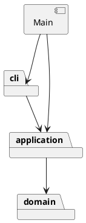

# 架构方案

## 本轮边界

第一轮实现 init、create rect、tree（含 tree id）、move；第二轮增加 circle；第三轮增加 ellipse、line、text。
第四轮增加 g 容器、create ... in、嵌套 tree 和整组 move；第五轮增加 scale、set、show。
后续继续树结构编辑、撤销重做和文件读写。
当前不是完整的 Phase 1 提交版本；不创建 final tag。

## 模块职责与依赖

| 目录 | 职责 | 允许依赖 |
| --- | --- | --- |
| src/domain | Shape、五类叶子、GroupShape、SvgDocument；封装几何行为、对象树、唯一 id 和查找 | 本模块、语言标准库 |
| src/application | 当前文档会话、Command 与具体命令；组织一次操作，定义输入 token 的只读元数据 | domain、本模块 |
| src/cli | 分词、唯一命令分派入口、终端读写和错误显示 | application，本模块 |
| src/Main.ts | 组装并启动应用 | cli、application |

领域层不读终端、不写 console、不访问文件。命令只调用对象行为，不直接改坐标。
初期把文本描述方法放在模型中，减少学习入口；树和显示复杂后评估提取 presentation。

## 设计模式

- Command（任务书要求）：InitCommand、CreateCommand、MoveCommand、TreeCommand、ScaleCommand、SetCommand、ShowCommand 实现相同 execute 契约。CLI 统一执行命令，不包揽业务。
- 多态与封装：Shape 定义行为，RectShape/CircleShape/EllipseShape/LineShape/TextShape 各自实现几何变化；文档保存 Shape，MoveCommand 不判断图形类型。
- Composite：GroupShape 与叶子均为 Shape；组递归准备孩子的移动/缩放，tree 通过统一的 getChildren 遍历。普通 g 的 set 只改变自身样式，不向孩子复制；delete 待后续实现。
- 移动与缩放的准备与提交：Shape.move/scale 先校验参数，再调用受保护的 prepareMove/prepareScale。叶子计算新几何值，组汇总孩子的更新；全部准备成功才同步执行只赋值的回调。回调不保存为历史，不把此机制表述为所有编辑命令的通用事务。
- 属性封装：Shape 私有样式集合统一管理 fill/stroke/stroke-width；各子类通过 setGeometryAttribute 校验自身白名单。单属性先校验再赋值；geometryAttributes 返回展示用快照，字段仍是私有状态。
- 仅两处名称分派：CommandDispatcher（命令名 → 命令类）与 ShapeFactory（类型名 → 图形类）。两处均标注待重构为注册入口；本轮不制作动态插件框架。

## 变化点假设与取舍

1. 新增图形：保留 Shape 行为契约和集中工厂；按增量增加具体类。
2. 新增命令或撤销：命令对象保留操作意图；历史策略在后续比较逆操作与快照后确定。
3. 图形嵌套：文档维护根节点顺序及全局 id 索引；GroupShape 管理私有孩子。后续迁移和删除需同步维护树与索引，并扩展父级管理。
4. 终端以外的入口：命令和领域对象不依赖终端，可以复用。
5. 文件读写：届时新增基础设施模块，当前不提前创建空接口。
6. 父级查询：show 暂时扫描树的直接孩子找到父级，复杂度 O(N)，避免提前维护额外父级索引。后续树迁移阶段结合变更操作重新评估。

## 本轮具体约定

- init 无参数为 800×600，单参数只改变宽；画布尺寸必须是有限正数。
- 几何坐标允许负数和小数；矩形宽高、圆形半径、椭圆两条半径为有限非负数，允许零尺寸。几何尺寸非负是本实现的校验约定。
- 移动先计算并检查全部新坐标，再统一赋值，避免一项成功一项失败。
- fill / stroke 省略时保持未指定；线段的可选样式是 stroke。
- scale 的正因子同时乘位置和尺寸；stroke-width 属于样式，不参与几何缩放。text 只缩放 x/y，不修改内容，也不引入白名单外的 font-size。
- set 仅接受课设公共样式和各类型几何白名单，文字另有 text 伪属性；普通 g 只支持公共样式。stroke-width 采用有限非负约定，颜色字符串暂不进行完整 CSS 语法校验。
- 组样式保存在组，未指定子样式保持缺省、显式子样式保持原值；后续 SVG 输出保留这种继承关系。本轮只验收模型存储，未验收浏览器渲染。
- show 显示直接父级和自身显式属性，根级父级为 svg；几何字段使用 width/height 等完整名称，文字用引号显示；不计算继承后的最终样式。
- 空行和 # 开头的整行注释跳过，颜色参数中的 # 作为普通文本。
- text 内容支持中文、空格、空字符串及转义引号；移动不改变文本。
- 双引号分组是任务书要求；引号前的反斜杠奇偶转义为本实现约定：2n 个反斜杠产生 n 个并切换引号状态，2n+1 个产生 n 个及字面引号。其他位置反斜杠原样保留。
- create 尾缀只识别末尾未加引号的 in 和其目标；quoted 元数据通过 CommandToken 传递，避免把文字内容误当成语法。
- 根元素由 SvgDocument 表示，没有伪造可被用户寻址的 g 根节点。
- appendChild/markAttached 是树结构内部接口，只允许文档插入流程使用；编辑命令不可绕过文档直接修改层级。它们检查重复挂接、自包含，子节点视图是冻结快照。

## Git 记录规则

根据用户明确要求，每轮有效更新在验证后形成提交，并推送到独立远程仓库。
提交包含对应代码、测试和文档修订；每轮报告实际提交号与同步状态。
不改写已有提交来伪造学习过程，用户手动验收和观点仅按其实际反馈记录。

## 后续迭代安排

以下是当前方案，按功能和验收点安排；每阶段可分成一至两轮，不一次实现完全部阶段。
每轮依次完成目标说明、有限实现、测试/代码复核、过程记录、Git 提交和推送，再结合用户反馈继续。

| 阶段 | 实现范围 | 验收重点 | 学习与设计讨论 |
| --- | --- | --- | --- |
| 属性与几何编辑（已实现） | scale、set、show | 第五轮新增 10 组测试通过；用户手动反馈待补充 | 几何与样式的区别；普通 g 样式保留继承语义，不能照搬未来 box 的传播规则 |
| 树结构编辑 A | delete、front、back | 删除容器包含全部后代并释放 id；调整顺序仅限同级；tree 正确反映结果 | 对象树与索引如何一起保持一致；数组顺序与 SVG 绘制顺序的关系 |
| 树结构编辑 B | group、addto、ungroup | 防祖先/后代成环；分组保序；addto 放最后；解组原位提升；按题意拒绝解散根级 g；失败不变 | 先讨论跨父级分组放置与顺序（题目未完全定义），再写入设计约定 |
| 撤销与辅助命令 | undo、redo；help、canvas | 一条编辑一个单元；撤销后新编辑清 redo；失败/查询不破坏历史；init 与 canvas 修改后禁用历史 | 对比逆操作和快照，选择能正确恢复几何、文本、树和顺序的方案；先提供建议再讨论取舍 |
| SVG 保存 | save、默认路径规则、IO 历史边界 | 正确命名空间与文本转义；省略未指定样式；保存失败不清历史；成功保存后禁用 undo/redo；浏览器预览 | 模型与 XML/文件 IO 的职责分离；首次无路径保存与默认路径约定 |
| SVG 读取 | read、补 id、往返验证 | 预留全部显式 id，再补缺失 id 并警告；重复 id/损坏文件不替换当前文档；读回层级、顺序和样式一致 | 明确外部 SVG 支持范围；背景示例含 transform，需要在实现前讨论是否纳入，不能静默丢弃 |
| 最终验收与交付 | 完整示例、边界测试、架构审查、文档与 final | 第 6 节和 6.1 版本 A 回放；错误文本及状态核对；一类一文件、依赖与两处分派检查；远程 main 与 final 均验证 | 对照最初方案解释真实改动；过程记录不代写尚未发生的学习体验 |

文件读写加入时再引入 infrastructure 及必要接口；展示和树查询复杂化时评估提取 presentation，实际改动同步修订上方依赖图。
box、动态插件框架和图形界面均不列入本期交付。
当前尚未提供课设截止日期，最终 tag 的实际完成时间需要在截止时间之前；不把本表当作已确认的日历排期。

# 过程记录

## 2026-10-29：重新开始分步协作

- 背景：此前 AI 一次完成整个参考工程。用户指出这不符合其参与学习的目标；随后逐函数练习又过细。
- 用户明确要求适中粒度：AI 分阶段实现，用户参与设计判断、关键代码审查与运行验证。
- 本轮用户要求建立新 Git 仓库。新仓库从配置和本设计草案开始，旧工程保留作为参考。
- 第一轮验收目标为最小矩形编辑流程，以及重复 id、无效输入、缺失目标时状态不变。
- 用户尚未评价本轮具体实现或完成手动验收，后续如实补充其反馈，不预写学习成果。

## 2026-10-29：最小矩形编辑流程

- 工程配置和实现前草案先作为独立初始提交，随后才编写本轮功能。
- AI 实现四条命令，使用 Command 对象组织操作；Shape 是抽象基类，RectShape 封装几何数据，SvgDocument 维护 id 唯一性。
- 本轮重点取舍：暂时让 describe/tree 返回文本以控制复杂度；保留明确模块边界，后续显示复杂后再讨论提取展示模块。
- 正确性处理：先验证完整新坐标再修改；先构造有效画布再替换当前文档；检查重复 id 后才插入集合。
- AI 独立只读复核未发现本轮范围内的问题；9 组测试通过，另在真实交互终端验证 svg> 提示符和最小命令链。
- 用户参与状态：已提出并纠正协作粒度、明确要求独立新仓库；本轮具体代码阅读与手动验收仍待反馈。

## 2026-10-29：增加圆形，检验多态复用

- 用户要求“继续”，没有提供上一轮的具体运行反馈；这表示继续推进，不记为用户已完成手动验收。
- 本轮目标限定为圆形，借助第二种具体图形检验第一轮的接口设计。
- 新增 CircleShape，扩展 ShapeFactory 的类型分支，更新 CLI 支持类型提示。
- 检查 Git 差异：Shape、SvgDocument、EditorSession、所有 Command 以及命令分派器均未修改；几何差异局限在具体图形内。
- 本轮取舍：矩形和圆形分别维护移动算法，暂不抽出位置基类。后续线段有两个端点，容器管理子图形，不能为了消除当前少量重复就假设所有图形都只有一对位置坐标。
- 工厂仍需为 circle 增加分支；这是明确保留并标注待重构的类型分派点，当前并非动态插件架构。
- 新增 5 组测试，与原来 9 组共同通过；独立只读复核未发现本轮需要修复的问题。
- 待讨论：统一 move 接口为什么足够，而统一 x/y 字段未必适用于所有图形。等待用户实际阅读与反馈后记录其观点。

## 2026-10-29：五类叶子图形与文字输入

- 用户要求继续，并明确每次更新都需要 Git 提交和远程仓库记录。本轮将该约定写入 README 与本文件。
- 本轮新增椭圆、线段、文字，仍只提供创建、移动和查询，没有推进容器、撤销与文件读写。
- 线段用两个端点检验上一轮的取舍：MoveCommand 只依赖 move 行为，不需要假设图形有单一 x/y。
- 三个新类分别封装自身几何值；线段同时校验四个新坐标，第四个坐标溢出时前面三个也不修改。
- 文字沿用双引号参数分组；为表达内容中的双引号，补充仅作用于引号前的反斜杠奇偶规则。普通反斜杠和 UNC 文本保持原样。这是实现语法选择，任务书没有规定具体转义语法。
- 首次编译发现 AI 编写的测试误用了 assert.throws 重载，将 undefined 放入必需的断言谓词位置。改用其消息参数重载后，严格编译通过；这说明测试代码本身也需要类型检查。
- 新增 10 组测试（7 组新图形与 CLI 测试，3 组分词测试），与原有 14 组共同通过。
- 独立只读复核检查线段原子性、文字转义和名称分派位置，未发现本轮需要修复的问题。
- 用户目前的参与是确定推进节奏和 Git 要求；本轮具体代码理解、运行体验与意见尚待反馈，不预先写成已完成。

## 2026-10-29：容器与嵌套移动

- 用户要求继续并给出后续项目安排，本轮限定为 g / in / tree / move，并加入按验收点分阶段的后续计划。
- 新增 GroupShape，将原有平面文档改为根节点列表、容器子列表和全局 id 索引；插入前完成父容器与 id 校验。
- 直接逐个调用 child.move 会有半组已移动的问题，因此把原有叶子的“计算/校验后赋值”拆成 prepareMove 和同步提交，组先准备所有孩子后再一起提交。
- prepareMove 及跨子节点辅助方法设为 protected，外部命令仍调用 move，不暴露可长期保存的更新回调。空组也在 Shape.move 中检查有限位移。
- 新增只读 CommandToken 接口记录是否带引号；分发器统一传递元数据，CreateCommand 解析未加引号的 in 尾缀，不按图形类型猜测参数。
- MoveCommand、TreeCommand 沿用原实现；CreateCommand 与文档因父容器需求演进，改变的位置与新增职责对应。
- 新增 10 组测试，总计 34 组通过。实际回放课设流程图的创建及移动部分；撤销、修改文字和保存尚未实现，没有把整个示例标为完成。
- 独立只读复核检查整组移动原子性、索引同步和 in 尾缀解析，未发现本轮需要修复的问题；未来树重排需重新验证归属与索引规则。
- 用户未提供本轮手动验收反馈；后续记录其实际提出的问题与观点。

## 2026-10-29：几何缩放、属性编辑与查询

- 用户要求继续，本轮按既有安排限定为 scale、set、show，没有提前实现剩余命令。
- 新增三个 Command，公共样式从叶子的单个字段收拢至 Shape 私有集合；几何值仍在各具体类内，由各类执行属性白名单和数值校验。
- 复用上一轮准备后统一提交的做法实现整组缩放；正因子也乘位置，样式与文字内容保持不变。空组在公共入口照常验证因子。
- 普通 g 只保存自身的样式；显式子样式保留，不照搬未来 box 的传播规则。show 输出直接父级和显式属性，不把继承值伪装成对象自己的值。
- 新增 10 组测试，包括五种叶子最后字段溢出时整组保持原样、完整几何白名单、公共样式、文字修改、嵌套父级及真实 CLI 回放。
- 首轮运行 43/44 通过：AI 编写的测试把既有负尺寸错误文字写成了 must be non-negative，实际 Numeric 使用 must not be negative。核对原实现后修正测试预期，重新严格编译及运行，44/44 通过。
- 独立只读复核检查原子性、白名单、组样式和父级显示，未发现本轮需要修复的问题。
- 用户未反馈实际运行结果或代码理解情况，本轮学习讨论待其反馈；浏览器样式继承到 SVG 保存阶段再验证。

# 一致性自查

当前实现与三层方案一致，src 下 23 个类各自放在同名文件，另有 CommandToken 只读输入接口。

- 抽查 MoveCommand：只依赖 application 与 domain，调用 shape.move，不直接修改几何字段。
- 抽查六类图形及 SvgDocument：只依赖 domain，没有 Node、终端或文件 IO 依赖。
- CommandDispatcher 依赖 application，集中处理命令名称；ShapeFactory 集中处理图形类型名称。代码中两处都有待重构说明。
- CommandTokenizer 和 Numeric 分别放在 cli 与 domain，是各自职责的辅助类，不增加反向依赖。
- 容器增量修改 CreateCommand 与文档职责，移动/查询命令沿用原实现；容器能力通过多态提供，没有按 tag 添加分散的判断。
- CommandToken 是不负责业务行为的只读输入元数据，不是公共数据袋形式的图形模型；application 不反向依赖 cli。
- ScaleCommand 和 SetCommand 调用对象行为，不根据图形类型分派；各类内部的属性白名单判断属于自身校验职责。
- Composite 已在移动、缩放与遍历中实现；树结构编辑、历史管理和持久化尚未实现，因此这里只是前五个增量的一致性检查。

# 质量保证手段

执行 `npm test`：TypeScript 严格编译通过，Node 内置测试运行器 44/44 通过（第一轮 9 组，第二轮 5 组，第三轮 10 组，第四轮 10 组，第五轮 10 组）。

| 验证内容 | 结果 |
| --- | --- |
| 最小命令链、位置变化、尺寸和样式保留 | 通过 |
| 默认/单参数 init、成功替换、失败保留文档 | 通过 |
| 未初始化操作、重复 id、大小写敏感、缺失目标 | 通过 |
| 连续移动、负数、小数 | 通过 |
| 参数数量、非法数值、负尺寸、未知命令/类型 | 通过 |
| 第二坐标溢出时第一坐标仍不变 | 通过 |
| 空行、整行注释、引号参数、可选 fill | 通过 |
| 子进程运行真实 CLI，错误文本与失败后状态 | 通过 |
| 矩形和圆形使用相同命令入口、跨类型 id 唯一性 | 通过 |
| 圆心移动、半径保留、零/负半径约定、坐标溢出 | 通过 |
| 第二轮真实 CLI 混合图形回放 | 通过 |
| 椭圆圆心平移与半径保留，线段两端一起移动 | 通过 |
| 线段第四坐标溢出时全部坐标保留 | 通过 |
| 中文、空文本、带空格内容与字面引号 | 通过 |
| 引号前反斜杠奇偶规则、普通反斜杠与 UNC 文本 | 通过 |
| 五类图形共享 id、第三轮真实 CLI 脚本 | 通过 |
| 嵌套 tree、tree id、选择子树移动与五类孩子各移动一次 | 通过 |
| 末尾子孙溢出时整组原样保留；空组仍校验位移 | 通过 |
| 父容器错误、跨层 id 重复、失败后 id 仍可用 | 通过 |
| 带引号的 in、名为 in 的容器、只读孩子列表、防循环/重复挂接 | 通过 |
| 100 层容器嵌套、课设流程图创建与组移动部分的真实 CLI 回放 | 通过 |
| 嵌套组缩放位置与尺寸，文字内容和描边宽度保持不变 | 通过 |
| 五种叶子最后几何字段溢出，整组不变；空组因子校验 | 通过 |
| 各类型几何白名单、六类公共样式、文字属性修改、非法修改不变 | 通过 |
| 普通组保留自身样式，子元素显式/缺省样式保持；show 直接父级与只读行为 | 通过 |
| 第五轮真实 CLI 回放、精确错误提示及失败后的属性查询 | 通过 |
| 交互终端 svg> 提示符和最小命令链 | AI 验证通过 |
| 用户手动验收与关键代码讨论 | 待用户反馈 |

功能测试文件为 tests/FirstIncrement.test.ts、tests/CircleIncrement.test.ts、tests/LeafShapesIncrement.test.ts、tests/CommandTokenizer.test.ts、tests/GroupIncrement.test.ts 与 tests/AttributeIncrement.test.ts；回放脚本为 examples/step-01.commands.txt 至 examples/step-05.commands.txt。
一组测试可以覆盖多个边界用例；以上表格不表示每行均对应一个独立测试。

本轮分词器的转义语法已明确，但保存/读取尚未实现；反斜杠文本测试不能代替未来真实文件路径验收。
当前叶子及整组 move/scale、单属性 set 都有失败不变保证；后续其他多对象编辑操作仍需分别验证整条命令的原子性。
用户手动体验与设计讨论独立记录，未实现功能不记为测试通过。
