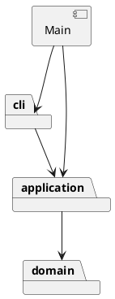

# 架构方案

## 本轮边界

第一轮仅实现 init、create rect、tree（含 tree id）、move。
create 的 in 子句、其他五种图形、其他编辑命令、撤销重做和文件读写在后续增量实现。
当前不是完整的 Phase 1 提交版本；不创建 final tag。

## 模块职责与依赖

| 目录 | 职责 | 允许依赖 |
| --- | --- | --- |
| src/domain | Shape、RectShape、SvgDocument；封装几何行为、唯一 id 和查找 | 本模块、语言标准库 |
| src/application | 当前文档会话、Command 与具体命令；组织一次操作 | domain、本模块 |
| src/cli | 分词、唯一命令分派入口、终端读写和错误显示 | application，本模块 |
| src/Main.ts | 组装并启动应用 | cli、application |

领域层不读终端、不写 console、不访问文件。命令只调用对象行为，不直接改坐标。
初期把文本描述方法放在模型中，减少学习入口；树和显示复杂后评估提取 presentation。

## 设计模式

- Command（任务书要求）：InitCommand、CreateCommand、MoveCommand、TreeCommand 实现相同 execute 契约。CLI 统一执行命令，不包揽业务。
- 多态与封装：Shape 定义行为，RectShape 实现几何变化；文档保存 Shape，后续增加图形无需让 MoveCommand 判断图形类型。
- Composite：后续容器增量再实现，并用嵌套组移动验证。当前不能声称已实现 Composite。
- 仅两处名称分派：CommandDispatcher（命令名 → 命令类）与 ShapeFactory（类型名 → 图形类）。两处均标注待重构为注册入口；本轮不制作动态插件框架。

## 变化点假设与取舍

1. 新增图形：保留 Shape 行为契约和集中工厂；按增量增加具体类。
2. 新增命令或撤销：命令对象保留操作意图；历史策略在后续比较逆操作与快照后确定。
3. 图形嵌套：当前文档管理平面集合，下一阶段改为对象树，并扩展全局 id 检查。
4. 终端以外的入口：命令和领域对象不依赖终端，可以复用。
5. 文件读写：届时新增基础设施模块，当前不提前创建空接口。

## 本轮具体约定

- init 无参数为 800×600，单参数只改变宽；画布尺寸必须是有限正数。
- 几何坐标允许负数和小数；矩形宽高为有限非负数。几何尺寸非负是本实现的校验约定。
- 移动先计算并检查全部新坐标，再统一赋值，避免一项成功一项失败。
- fill 省略时保持未指定，不擅自填成 black。
- 空行和 # 开头的整行注释跳过，颜色参数中的 # 作为普通文本。

# 过程记录

## 2026-10-29：重新开始分步协作

- 背景：此前 AI 一次完成整个参考工程。用户指出这不符合其参与学习的目标；随后逐函数练习又过细。
- 用户明确要求适中粒度：AI 分阶段实现，用户参与设计判断、关键代码审查与运行验证。
- 本轮用户要求建立新 Git 仓库。新仓库从配置和本设计草案开始，旧工程保留作为参考。
- 第一轮验收目标为最小矩形编辑流程，以及重复 id、无效输入、缺失目标时状态不变。
- 用户尚未评价本轮具体实现或完成手动验收，后续如实补充其反馈，不预写学习成果。

## 2026-10-29：最小矩形编辑流程

- 工程配置和实现前草案先作为独立初始提交，随后才编写本轮功能。
- AI 实现四条命令，使用 Command 对象组织操作；Shape 是抽象基类，RectShape 封装几何数据，SvgDocument 维护 id 唯一性。
- 本轮重点取舍：暂时让 describe/tree 返回文本以控制复杂度；保留明确模块边界，后续显示复杂后再讨论提取展示模块。
- 正确性处理：先验证完整新坐标再修改；先构造有效画布再替换当前文档；检查重复 id 后才插入集合。
- AI 独立只读复核未发现本轮范围内的问题；9 组测试通过，另在真实交互终端验证 svg> 提示符和最小命令链。
- 用户参与状态：已提出并纠正协作粒度、明确要求独立新仓库；本轮具体代码阅读与手动验收仍待反馈。

# 一致性自查

本轮实现与三层方案一致，src 下 15 个类各自放在同名文件。

- 抽查 MoveCommand：只依赖 application 与 domain，调用 shape.move，不直接修改几何字段。
- 抽查 RectShape、SvgDocument：只依赖 domain，没有 Node、终端或文件 IO 依赖。
- CommandDispatcher 依赖 application，集中处理命令名称；ShapeFactory 集中处理图形类型名称。代码中两处都有待重构说明。
- CommandTokenizer 和 Numeric 分别放在 cli 与 domain，是各自职责的辅助类，不增加反向依赖。
- Composite、历史管理和持久化尚未实现；因此这里只是第一增量的一致性检查。

# 质量保证手段

执行 `npm test`：TypeScript 严格编译通过，Node 内置测试运行器 9/9 通过。

| 验证内容 | 结果 |
| --- | --- |
| 最小命令链、位置变化、尺寸和样式保留 | 通过 |
| 默认/单参数 init、成功替换、失败保留文档 | 通过 |
| 未初始化操作、重复 id、大小写敏感、缺失目标 | 通过 |
| 连续移动、负数、小数 | 通过 |
| 参数数量、非法数值、负尺寸、未知命令/类型 | 通过 |
| 第二坐标溢出时第一坐标仍不变 | 通过 |
| 空行、整行注释、引号参数、可选 fill | 通过 |
| 子进程运行真实 CLI，错误文本与失败后状态 | 通过 |
| 交互终端 svg> 提示符和最小命令链 | AI 验证通过 |
| 用户手动验收与关键代码讨论 | 待用户反馈 |

功能测试文件为 tests/FirstIncrement.test.ts，回放脚本为 examples/step-01.commands.txt。
一组测试可以覆盖多个边界用例；以上表格不表示每行均对应一个独立测试。

本轮分词器支持双引号包裹参数，尚未定义引号转义语法。引入 text、文件路径时再评审其需求。
当前只有单个矩形变更的失败不变保证；后续对容器及多对象修改，需要另行验证整条命令的原子性。
用户手动体验与设计讨论独立记录，未实现功能不记为测试通过。
